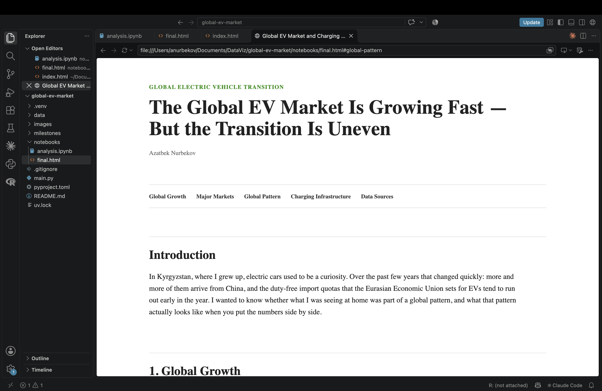

# Global EV Market and Charging Infrastructure

Azatbek Nurbekov

## Description

In 2025, one in four new cars sold worldwide was electric, but the transition has been very uneven. This project uses IEA data to show how fast the global EV market has grown, where electric cars are being sold, how adoption differs across countries, and how public charging networks compare across major markets. The final product is a narrative HTML article that combines ten static charts with explanatory text and a short discussion of the policies behind these differences.

## Screenshot



## Data Sources

International Energy Agency (2026). *Global EV Outlook 2026: EV data by country.* IEA, Paris. Licence: CC BY 4.0. [https://www.iea.org/data-and-statistics/data-product/global-ev-outlook-2026](https://www.iea.org/data-and-statistics/data-product/global-ev-outlook-2026)

Country boundaries for the world map: *world-atlas* (TopoJSON, 110m), derived from Natural Earth. [https://github.com/topojson/world-atlas](https://github.com/topojson/world-atlas)

The analysis uses historical observations (2010–2025) for passenger cars. Sources for the policy discussion (Norway, China, Europe, the United States, Japan, and Nepal) are cited directly in the final HTML page.

## How to Run

Install dependencies and run the notebook from the repository root:

uv sync
uv run jupyter nbconvert --to notebook --execute --inplace notebooks/analysis.ipynb

This regenerates all charts in images/. Open notebooks/final.html in a browser to view the article.

### Tools

Python, pandas, Altair, pycountry, HTML, and CSS.

## Repository Structure

```text
├── data/
│   └── EV data by country 2026.xlsx    # IEA source dataset
├── notebooks/
│   ├── analysis.ipynb                  # generates all charts in images/
│   └── final.html                      # final narrative article
├── images/                             # exported charts
├── milestones/                         # proposal and draft submissions
├── Screenshot.png                      # final project screenshot
├── pyproject.toml
└── uv.lock


