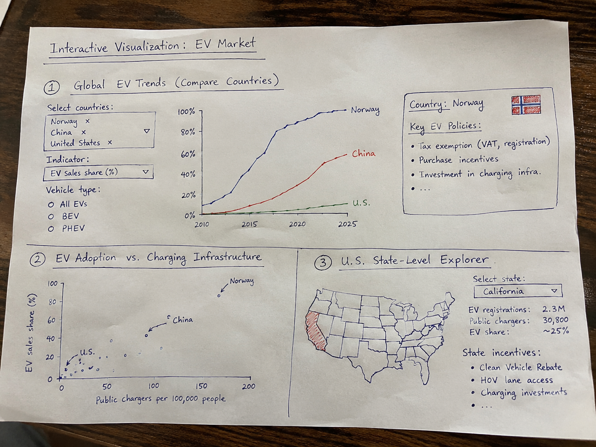

# Azatbek Nurbekov

## Description

For my static visualization project, I explored how the global electric vehicle market has grown and why adoption differs 
so much across countries. One thing that surprised me was how uneven the transition has been. Norway reached almost 97% EV sales share in 2025,
China 53%, while the United States remained around 10%.
For my interactive project, I want to give users more freedom to explore the data themselves. Rather than showing a fixed set of countries and 
indicators, I would like users to select countries, choose indicators such as EV sales, market share, vehicle stock, 
and public charging infrastructure, and compare how these have changed over time.

I also want to include information about government policies that may have influenced EV adoption. 
For example, when a user selects Norway, China, or another country, they could see a short summary of major policies, 
such as tax exemptions, purchase subsidies, or charging infrastructure investments. 
This would help connect the differences in adoption to the policy decisions made by individual countries.

Finally, I would like to add a separate section focusing on the United States. 
Users could select individual states and compare EV registrations, charging infrastructure, and state-level incentives. 
I think it would be interesting to explore why states such as California have developed much larger EV markets than others.

My goal is to create an interactive data story that allows readers to move from global trends to individual countries 
and then explore differences within the United States.

## Technical Plan: B

I'm planning to follow Option B: Dynamic Ensemble, with several connected interactive visualizations.

Global EV trends: A line chart where users can select countries, choose indicators, and compare changes over time. 
They could also switch between BEVs and PHEVs.

Country comparison and policies: An interactive scatterplot or bar chart comparing EV adoption and charging infrastructure. 
Selecting a country would display its main EV policies alongside the data.

U.S. state-level exploration: An interactive U.S. map where users can select states and compare EV registrations, 
public charging infrastructure, and government incentives.

I'm considering linking the visualizations so that selecting a country 
or state updates the relevant charts and information panels.

## Libraries:

D3.js for interactive visualizations and maps

JavaScript, HTML, and CSS

Python/pandas for data cleaning and preparation

## Inspiration:

Our World in Data: I like how users can select countries and indicators to explore trends over time.

IEA Global EV Data Explorer: I like the ability to compare EV markets using different indicators.

The Pudding: I like the combination of interactive visualizations and explanatory storytelling.

## Mockup

The mockup will illustrate a webpage with a country selector, indicator selector, interactive charts, 
a policy information panel, and a separate U.S. state comparison map.

## Data Sources:
### Data Source 1: IEA Global EV Outlook 2026
URL: https://www.iea.org/data-and-statistics/data-product/global-ev-outlook-2026

Size: approximately 49,500 rows, 9-12 columns

This dataset contains country level data on the global electric vehicle market. It includes EV sales, EV stock, 
EV sales share, EV stock share, public charging points, vehicle types, powertrains, and yearly observations. 
I have explored this dataset. It contains historical data from 2010 through 2025. 
I plan to use it to examine global EV market growth, compare countries.

### Data Source 2: U.S. Department of Energy Alternative Fuels Data Center: Electric Vehicle Registrations by State
URL: https://afdc.energy.gov/data/search?q=electric

Size: approximately 50 state-level observations for the most recent registration snapshot, 
additional historical vehicle-registration data are also available. This dataset provides counts of 
light-duty electric vehicles registered across US states. 
I plan to use it to compare EV market across states and to examine how different the US market is geographically. 
This data will be especially useful for comparing states such as California with other parts of the United States and for 
investigating whether differences in EV adoption are associated with state-level policies, infrastructure, or other characteristics.

### Data Source 3: U.S. Department of Energy Alternative Fuels Data Center: Alternative Fueling Station Locator
URL: https://afdc.energy.gov/data_download/new

Size: 10 000 of station-level observations; exact number of rows and columns will be 
determined after loading the EV-only dataset. This dataset contains detailed information on public electric
vehicle charging stations in the United States. I plan to use this dataset to examine the geographic distribution of 
EV charging infrastructure across the United States. Because the observations are available at the individual station level, 
I may be able to aggregate the data by state and potentially by county. I will use this source to compare charging infrastructure with EV adoption and identify places where the number of electric vehicles may be growing faster than the availability of public chargers.

### Data Source 4: U.S. Department of Energy Alternative Fuels Data Center: EV Laws and Incentives by State
URL: https://afdc.energy.gov/data/categories/laws-incentives

Size: To be determined after downloading the dataset. This dataset contains information on state-level laws and 
incentives related to electric vehicles and charging infrastructure. I plan to use it to explore whether states with more 
EV-related policies or incentives also tend to have higher EV adoption or more developed charging infrastructure. 
This analysis would be descriptive rather than causal, but it may help identify interesting differences between states.

## Questions

1. Is Option B appropriate for three connected interactive visualizations, including a country-level section and
   a separate U.S. state-level map?
3. Would you recommend keeping the global and U.S. sections mostly separate, or linking them through a shared comparison panel?
4. For policy information, would a panel that updates when a country or state is selected work better
   than annotating individual policy changes directly on the charts?
