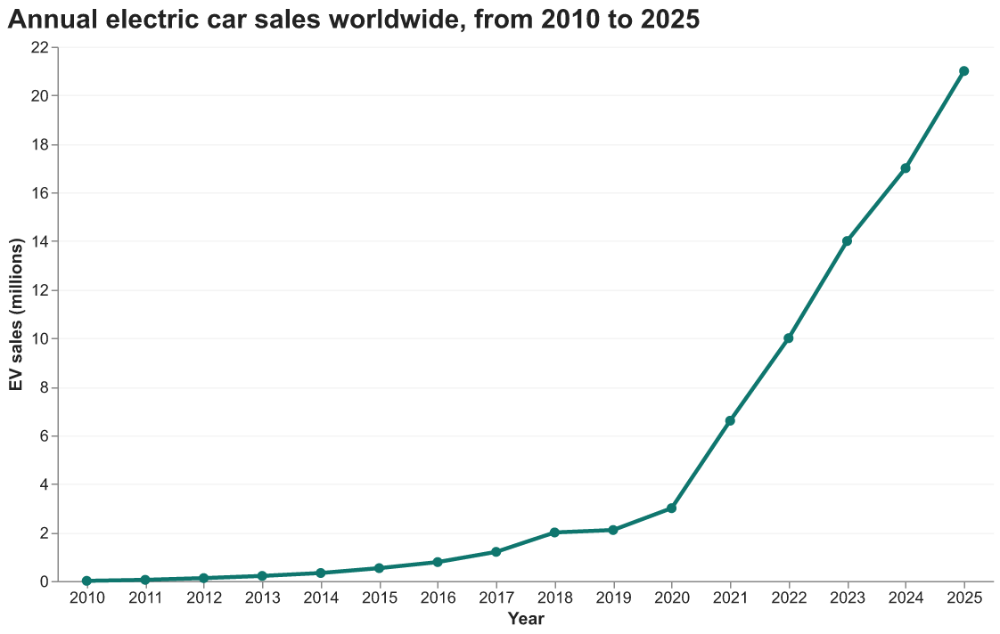
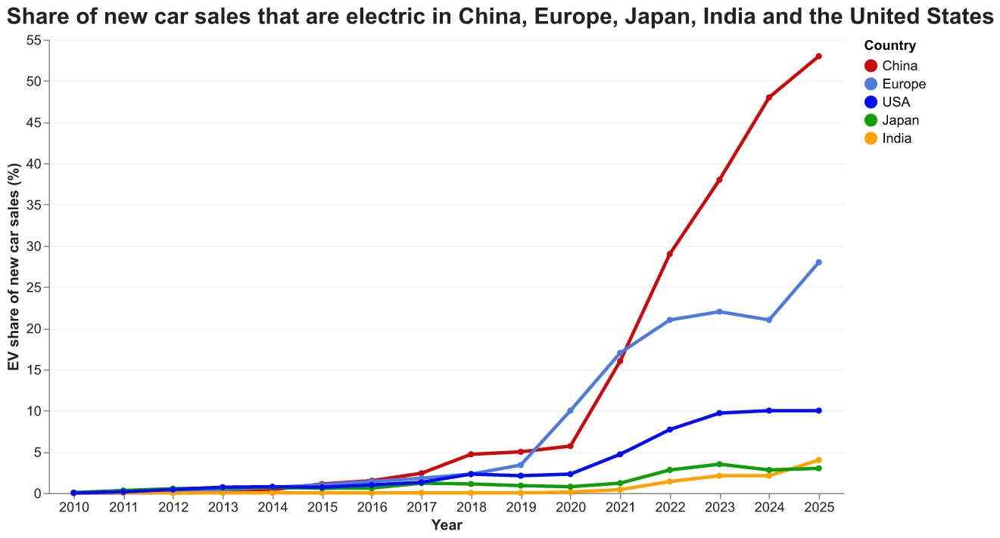
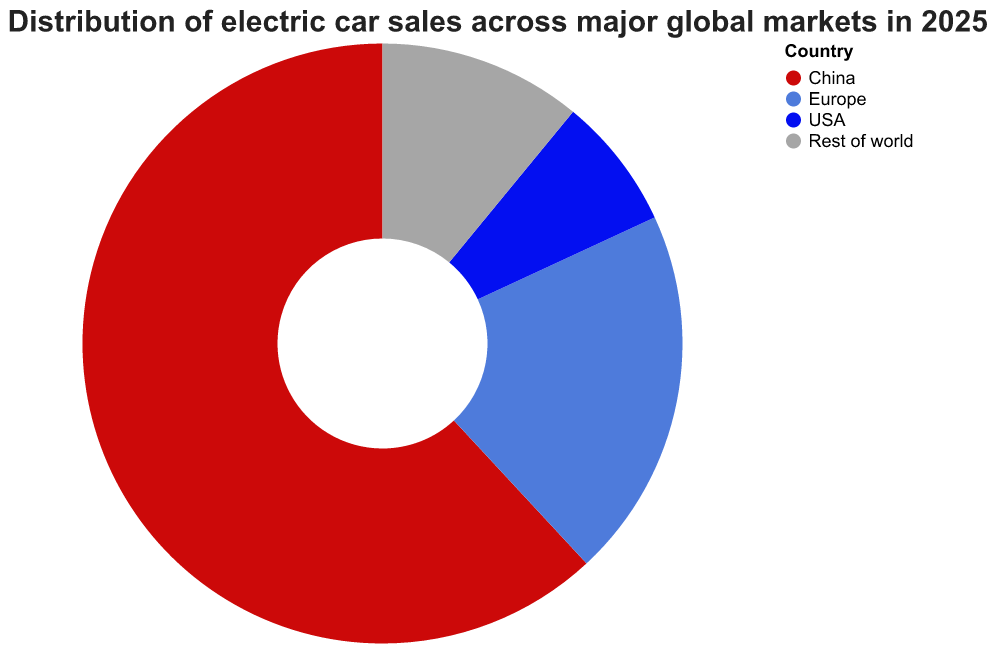
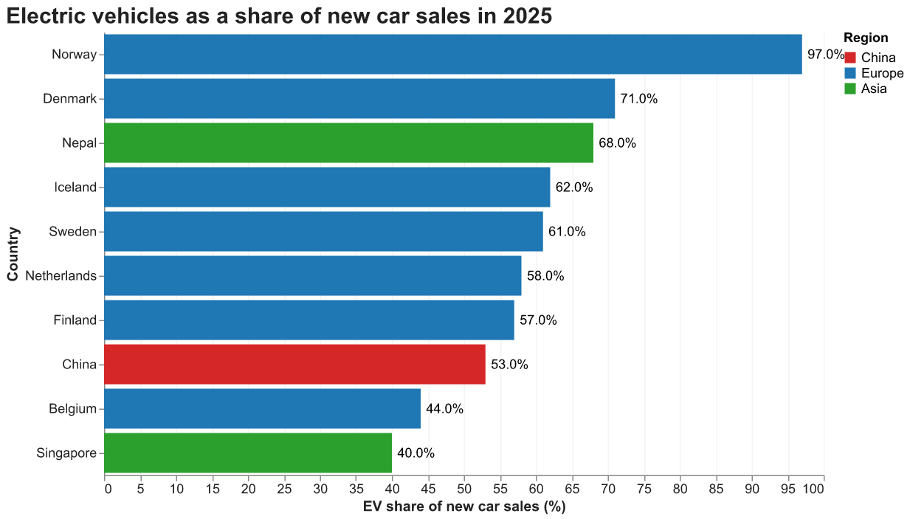
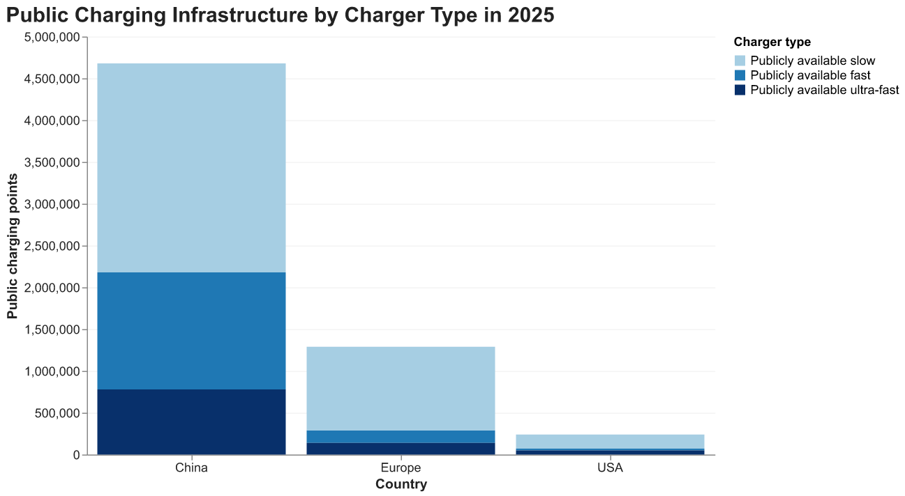
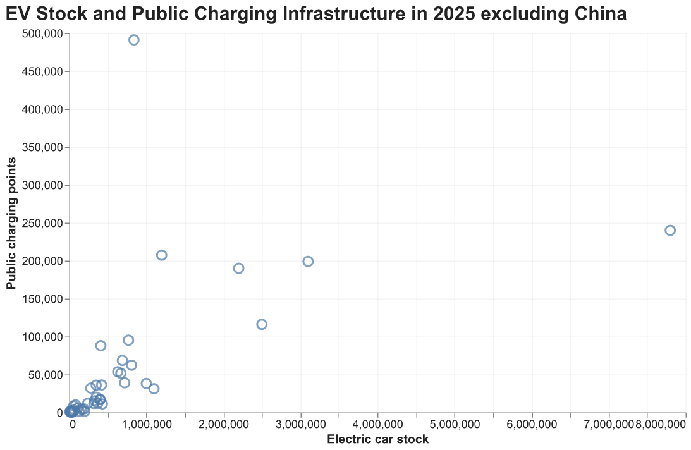
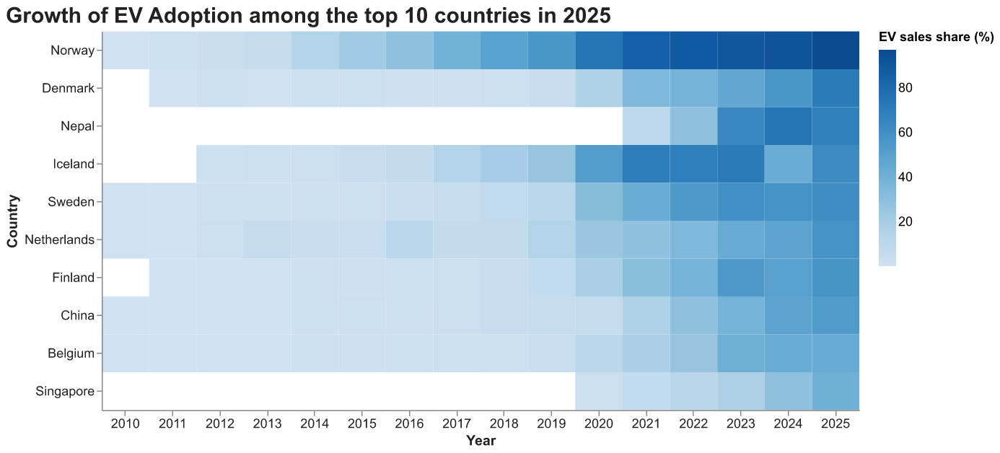
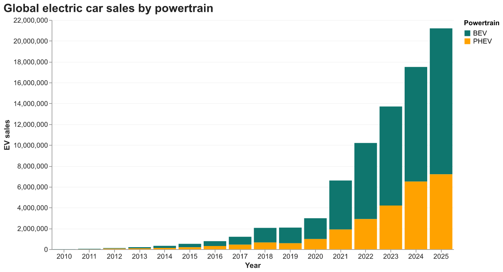
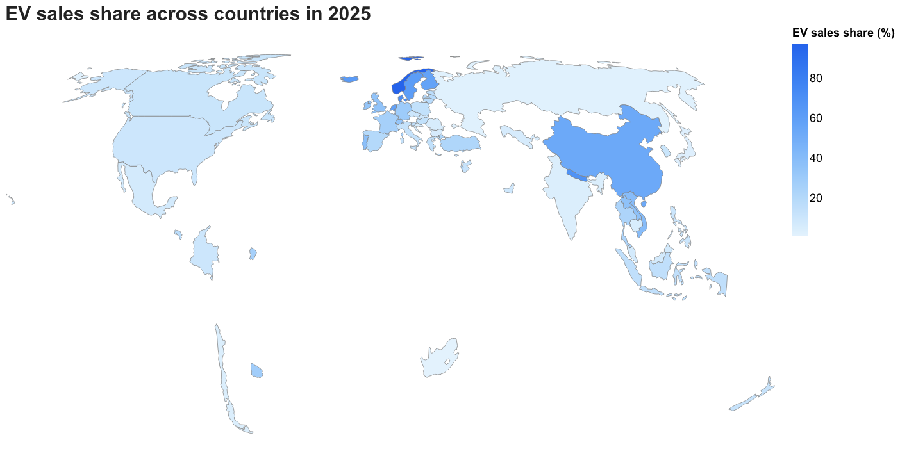

# Global EV Market and Charging Infrastructure

Azatbek Nurbekov

## What is your current goal? Has it changed since the proposal?

My current goal is to examine the growth of the global electric vehicle market and the development of charging infrastructure. 
The project begins with global trends in EV sales and market share, then compares major markets and individual countries, 
and finally looks at the relationship between EV adoption and charging infrastructure.

The overall goal has not changed substantially since the proposal. However, 
I have narrowed the scope by focusing more clearly on global and country level patterns 

## Are there data challenges you are facing? Are you currently depending on mock data?

The visualizations currently use real data from the IEA Global EV Outlook 2026 dataset. 
The dataset contains both individual countries and aggregate regions such as World, Europe, and Advanced Economies, 
so I created a separate countrylevel dataset for visualizations that require individual countries.

## Describe each of the provided images with 2-3 sentences to give the context and how it relates to your goal.

### 1. Global Electric Car Sales Over Time

I started my first visualization to examine how global electric car sales have changed over time. 
The chart provides the opening context for the project by showing the overall scale and pace of growth in the global EV market.

### 2. EV Sales Share Across Major Markets

This viz compares the share of new car sales that are electric in China, Europe, and the United States. 
It shows how EV adoption has progressed at different speeds across major markets.

### 3. Global EV Sales by Major Market in 2025

This chart shows the distribution of global electric car sales across China, Europe, the United States, 
and the rest of the world in 2025. This visualization highlights the geographic concentration of the global EV market.

### 4. Countries with the Highest EV Sales Share in 2025

While the previous chart shows where global EV sales are concentrated, 
this visualization compares how deeply EVs have penetrated individual national car markets.

The chart highlights the countries where electric vehicles accounted for the largest share of new car sales in 2025.

### 5. Public Charging Infrastructure by Charger Type in 2025

This chart compares the composition of public EV charging infrastructure in China, Europe, and the United States in 2025. 
It distinguishes between slow, fast, and ultra-fast public charging points and shows how both the scale and structure of charging networks differ across major EV markets.

### 6. EV Stock and Public Charging Infrastructure in 2025

This scatter plot compares the number of electric cars with the number of public charging points across markets in 2025. 
It helps examine whether countries with larger EV fleets also tend to have more developed public charging infrastructure.

### 7. Growth of EV Adoption Across Selected Countries

This heatmap depicts how the share of electric vehicles in new car sales changed over time across selected countries. 
Darker cells represent higher EV sales shares, making it easier to compare the timing and speed of EV adoption across national markets.

### 8. Global Electric Car Sales by Powertrain

This chart shows how global electric car sales have been divided between battery electric vehicles 
(BEVs) and plug-in hybrid electric vehicles (PHEVs) over time. It helps show which powertrain has contributed most to the rapid expansion of the global EV market.

### 9. EV Sales Share Across Countries in 2025

This world map shows the share of electric vehicles in new car sales across countries in 2025. 
It provides a geographic view of EV adoption and highlights how uneven the global transition to electric vehicles remains.

## What form do you envision your final narrative taking?

I currently envision the final project as an article-style narrative that combines explanatory text with a sequence of visualizations. 
The narrative would move from global EV market growth to differences across countries and markets, 
and then to the role of charging infrastructure in supporting EV adoption.
